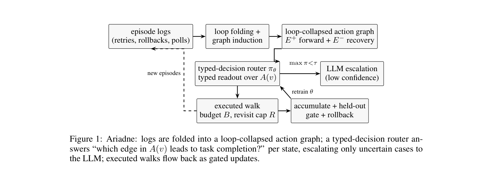

# NIOCIS — pseudonymized derived corpus (release)

Structure-only, pseudonymized derivatives of a production SOC agent-trace
study (22,328 Langfuse observations → 1,615 loop-folded episodes), released
with "NIOCIS: Typed-Decision Next-Hop Routing with Node-Conditioned Option Spaces
for Tool-Use Agents". The raw export is internal telemetry and is **not** part of
this bundle.

## Files

- `episodes.jsonl` — loop-folded episodes: salted-hash trace/session ids,
  generic agent stage, action-label codes, fold events (retry/back),
  back-edge index pairs, per-call latencies (numbers only).
- `e2_{train,val,test}.jsonl` — the decision dataset (70/10/20 split,
  split = sha256-family rule on the original trace id): hashed trace,
  codified cur/target/options, observable state + feature fields.
- `e2_meta.json` — codified action vocabulary (154 `act_NNN` codes; the stop
  token is the separate `stop` field) and
  edge counts; the edge vocabulary itself is a pure function of the fold.
- `outcome_labels.jsonl` — hashed trace → derived outcome
  (`completed`/`blocked`/`abandoned`; the close-out convention of §5).
- `corpus_summary.json` — counts, catalog-by-steps (codified), fold totals.
- `RESIDUALS.txt` — transparency record for the dropped free-text
  judge/adjudicator rationales: per-string count, kind, word count and salted
  hash only (no text, and nothing else).

## Withheld by design

- the action-code ↔ internal-name mapping (codes are assigned by a
  salt-derived permutation, so knowing the label set does not reveal it) and
  the identifier hash salt,
- tool-argument payloads and chat bodies (absent from the export anyway),
- free-text judge/adjudicator rationales (dropped; see `RESIDUALS.txt`),
- the raw Langfuse export.

Identifiers are SHA-256(salt‖id) hex prefixes under a private salt, so
low-entropy internal ids cannot be dictionary-recovered from the hashes.

Re-identification note: per-action frequencies and shapes are preserved by
design (the decision rows, and the counting summaries), so a reader who already
holds external priors over this tool family's usage can partially narrow a code
to a candidate name. The code assignment itself is a salt-derived permutation
and the label set alone does not determine it (verified: a best-case attacker
supplied with the exact 154-name set recovers ~1 code by chance).

## Reproducing

The pipeline in the paper's `experiments/` (parse_real_corpus.py,
e1_real.py, e2_build.py, e2_train_torch.py, …) runs against this bundle as
is inside the pinned container; alternatively, feed
`parse_real_corpus.py` any Langfuse-style observations export of your own.
Leak and integrity gates: `experiments/verify_release.py` (27 checks).

One-command entry points (all inside the pinned container): `chain_pub.sh`
(fetch → XES parse → fold statistics → tables/figures) for the public event
logs; the tool-trajectory chain (`pub_tool_fetch.py` → `pub_tool_parse.py` →
`pub_e2_build.py` → `pub_e2_train.py`, with the `pub_markov.py` /
`pub_coupon.py` add-ons); and asset regeneration via `make_tab_corpus.py`,
`render_figs_tabs_real.py` and `render_pub.py` for every table and figure of
the paper. A one-page reproduction checklist ships alongside the paper as
`repro_checklist.pdf`.

## License

CC BY 4.0 — the authors' organization's release approval was granted on
2026-10-10; this license is in force as written. The raw production export is
never distributed.